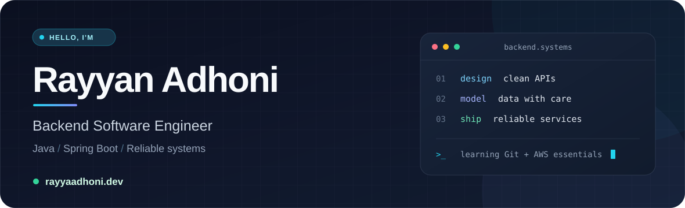

## 👋 About me

Hi, I'm Rayyan Adhoni, a backend software engineer working primarily with **Java and Spring Boot**. I enjoy building reliable APIs, modelling relational data, and designing services that are straightforward to test and maintain.

I'm expanding my experience with cloud deployment, distributed messaging, and real-time systems through hands-on projects.

---

## 🛠️ Technical stack

| Focus | Technologies |
|:---|:---|
| **Backend** |    |
| **Databases & messaging** |     |
| **Testing** |   |
| **Cloud & tools** |   |
| **Other languages** |    |

---

## 🚀 Featured projects

### 🏦 ScotBank · Banking system

`Java` · `Jooby` · `JUnit 5` · `Mockito`
 
A banking application built around an object-oriented account model. Service endpoints handle deposits, withdrawals, and transfers, with account state kept separate from business logic. Unit tests focus on the core transaction flows.

[Explore ScotBank →](https://github.com/MoRayyan107/ScotBank)

### 💬 Discord · Real-time messaging service

`Java` · `TCP sockets` · `Concurrency` · `Kafka` · `Redis`

A multi-user messaging service that handles concurrent TCP connections with a fixed thread pool. A `BlockingQueue` and dedicated dispatcher threads separate message delivery from client handling. Kafka carries messages between server instances, while Redis stores shared group and routing state.

[Explore Discord →](https://github.com/MoRayyan107/Discord)

### 🛡️ VaultGuard · Fraud detection engine

`Java 21` · `Spring Boot` · `Kafka` · `Redis` · `PostgreSQL` · `WebSocket`

**In development.** VaultGuard is a banking service project for assessing transaction risk in real time. The planned flow validates and stores incoming transactions, publishes them to Kafka for scoring, and sends alerts over WebSocket when a transaction is flagged. The design also includes JWT authentication and Redis-backed rate limiting.

[Explore VaultGuard →](https://github.com/MoRayyan107/VaultGuard)

---

## 📍 What I'm working on

- Strengthening my Git workflow and learning AWS essentials.
- Deepening my understanding of Kafka consumers, partitions, and message delivery.
- Exploring Redis caching patterns and rate limiting.
- Improving integration tests and automated deployment workflows.

---

## 📈 GitHub activity

[View my contributions on GitHub →](https://github.com/MoRayyan107?tab=overview)

## 🎓 Certifications

| Certificate | Issuer | Focus |
|:---|:---|:---|
| JPMC Forage Job Simulation | JPMorgan Chase & Co. | Software Engineering |

---

**Open to backend engineering roles, internships, and collaborations.**

[Email](mailto:rayyanadhoni107@gmail.com) · [LinkedIn](https://www.linkedin.com/in/mohammad-rayyan-adhoni) · [Portfolio](https://rayyaadhoni.dev/)

